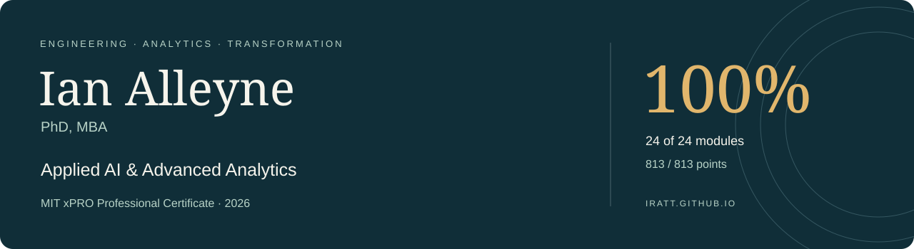

I connect **engineering judgment, data science and digital strategy** to make complex systems useful, reliable and understandable. My work brings together controls and automation, healthcare technology, responsible AI and operational leadership.

### MIT xPRO · Professional Certificate

**Advanced Analytics with AI, ML, and Data Science**

| Final overall result | Modules with full marks | Points earned | Graded activities |
|:---:|:---:|:---:|:---:|
| **100%** | **24 / 24** | **813 / 813** | **144** |

**[Explore my full portfolio →](https://iratt.github.io/)** · [All 24 modules](https://iratt.github.io/index.html#modules) · [Verify the certificate](https://certificates.emeritus.org/09a749b7-fb41-4777-8b93-559e1039989c)

### Selected work

| Case study | Decision and contribution |
| --- | --- |
| [Clinical AI](https://iratt.github.io/cases/clinical-ai.html) | A clinician-reviewed path from conversation to structured records and governed analytics. |
| [Alarm intelligence](https://iratt.github.io/cases/alarm-intelligence.html) | A staged strategy for contextual recommendations, local resilience and bounded automation. |
| [Production optimization](https://iratt.github.io/cases/production-optimization.html) | A production mix and capacity recommendation with a modeled **$2,316 weekly contribution** in the course case. |
| [Network logistics](https://iratt.github.io/cases/network-logistics.html) | A Gurobipy network-flow case with a recorded minimum transportation cost of **$541,000**. |

### Technical and leadership focus

**Prediction:** regression, classification, CART, XGBoost and recommendation systems.  
**Optimization:** linear programming, integer decisions and network flow.  
**AI:** neural networks, TensorFlow/Keras, transfer learning, NLP and transformers.  
**Implementation:** interpretability, fairness, human oversight, digital strategy and organizational change.

My academic foundation combines Electrical & Computer Engineering, a PhD in Chemical Engineering and an MBA.

---

Final recorded grades, including accepted resubmissions, reviewed on 4 November 2026. Numerical outcomes above are educational model results; clinical and alarm-management studies are proposals or portfolio extensions. Course cases and starter code retain their original attribution. [Evidence and authorship](https://iratt.github.io/methodology.html).
